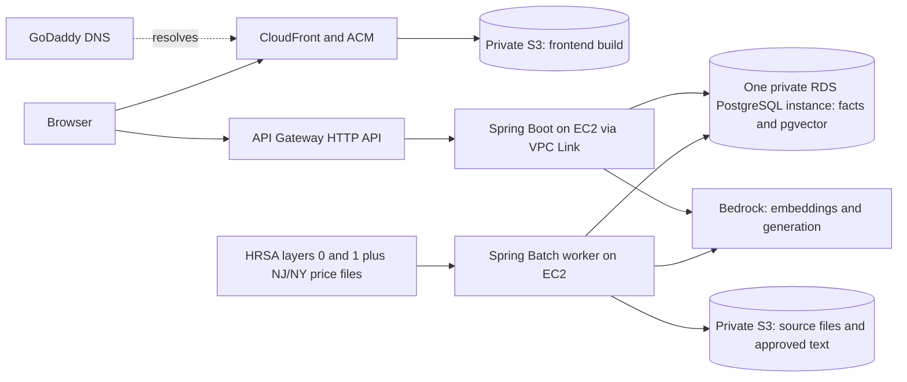

# NJ and NY pilot: AWS learning and build plan

Updated November 8, 2026. This is the current pilot scope: NJ and NY only, both
HRSA hospital layers, 10-20 curated procedures, and a small reviewed subset of
hospitals with published prices. No resources are provisioned by this plan.
Current implementation (November 19, 2026): the hospital directory runs locally
on MySQL through Spring Boot and React/Mapbox. See backend/README.md for startup.
The old RDS bootstrap/import utilities have been retired. The AWS steps below are
future work and require a refreshed whole-stack estimate before provisioning.

## Services and responsibilities

| Need | AWS evaluation | Chosen implementation and Spring Boot role | Verification |
| --- | --- | --- | --- |
| Domain and DNS | Route 53 is suitable but unavailable to the user. | Register the domain and manage DNS at GoDaddy. Spring Boot has no DNS responsibility. | Validate GoDaddy CNAME records and domain renewal cost. |
| Static frontend and HTTPS | CloudFront, S3, and ACM are suitable managed services. | Private S3 bucket holds the Vite build. CloudFront uses Origin Access Control. ACM provides the certificate. | Frontend loads over HTTPS; direct public S3 access is denied. |
| Hospital source files | S3 is suitable for large original files and provenance. | Separate private bucket stores raw files, manifests, and approved text. Spring Batch downloads and validates sources. | Hashes, source URLs, dates, retention, and scoped permissions. |
| Hospital facts and vectors | Managed RDS PostgreSQL supports pgvector and relational records together. A second RDS instance would duplicate baseline costs for this small pilot. | One private RDS instance; separate tables for locations, identifiers, prices, documents, and embeddings. Spring Boot owns migrations and queries. | Supported engine/extension version, TLS, restore drill, and measured memory/latency. |
| Managed retrieval alternative | Bedrock Knowledge Bases with S3 Vectors remains valid. Its documented native PostgreSQL vector-store integration uses Aurora; do not assume standard RDS is interchangeable. | Choose pgvector on the already selected RDS to meet the user's preference and consolidate pilot storage. Spring Boot handles chunking, embedding jobs, retrieval, and citations. No Knowledge Base or S3 Vectors resource in this configuration. | Compare exact/semantic results; reject out-of-catalog requests and stale documents. |
| Embeddings and generated explanations | Bedrock supplies both embedding models and generation models. | Spring Boot calls Titan embeddings for approved documents and user queries, searches pgvector, then calls a generation model with retrieved evidence and SQL facts. | Same embedding model/dimensions for documents and queries; token limits and supported claims. |
| Backend execution and API | S3 and CloudFront do not execute Spring Boot. EC2 fits the current pilot budget; API Gateway provides the public API boundary. | Spring Boot API and bounded Spring Batch worker on one EC2 host. Existing API Gateway/VPC Link/Cloud Map plan remains; use an HTTP Cloud Map namespace without Route 53 DNS. | API reachable; RDS stays private; only the VPC Link may reach the application port. |

## Request and ingestion flow

For a query: embed the phrase, retrieve approved procedure/document candidates in
pgvector, validate the requested procedure against the supported catalog, query
exact eligible prices in SQL, and generate an explanation using that evidence.
The model does not calculate or invent prices. User confirmation still resolves
ambiguous procedure candidates. Unsupported procedures remain unsupported.

## Build and learn in this order

1. **Local vertical slice:** the existing MySQL directory is served through Spring
   Boot and displayed in Mapbox. Review campus identity and prepare the limited
   NJ/NY price pilot before adding PostgreSQL/vector integration.
2. **Static hosting:** upload the built frontend to private S3, create CloudFront
   with OAC, and verify the supplied `cloudfront.net` hostname. Then add an ACM
   certificate in `us-east-1`, add `www.<domain>` as an alternate domain, and create
   its CNAME and ACM validation CNAMEs in GoDaddy. Use `www` first; root-domain
   routing/redirect support depends on the DNS provider's capabilities.
3. **AWS data and API:** complete the dated whole-stack price checks first. Create
   private RDS and the source S3 bucket, then deploy Spring Boot to EC2 and connect
   its API Gateway integration. Use the default HTTPS API endpoint first; add
   `api.<domain>` through GoDaddy and ACM after requests work. Verify migrations,
   private database access, TLS, backups, and repeatable NJ/NY imports.
4. **Real price comparison:** ingest two reviewed hospital files first. Publish
   comparable discounted cash prices for approved procedures. Pass when selection
   removes every hospital without an eligible price from markers and results;
   clearing it restores the directory. Expand hospital coverage after this works.
5. **Semantic search and RAG:** generate embeddings for the 10-20-procedure catalog
   and a bounded set of approved explanatory passages. Start with exact vector
   scans; add an approximate index only if measurements justify it. Demonstrate
   semantic matches, ambiguity handling, unsupported requests, and cited answers.
6. **Automation and operations:** wire bounded refresh jobs through
   EventBridge/SQS, configure usage limits/alerts, run a restore drill, and compare
   actual monthly spend with the estimate before expanding traffic or coverage.

Do not embed every raw price row or send an entire hospital file to the LLM.
Store exact prices as decimal SQL values. Large source files may still need a
full streaming parse to find the limited supported procedures.

The [whole-stack estimate](AWS_COST_ESTIMATE.md) is provisional. Combining vectors
with facts removes a second database's fixed cost but still uses RDS memory,
storage, and CPU; benchmark before committing to the smallest instance.

## Primary references

- [RDS PostgreSQL extension versions](https://docs.aws.amazon.com/AmazonRDS/latest/PostgreSQLReleaseNotes/postgresql-extensions.html)
- [Bedrock Knowledge Bases vector-store prerequisites](https://docs.aws.amazon.com/bedrock/latest/userguide/knowledge-base-setup.html)
- [CloudFront custom domains](https://docs.aws.amazon.com/AmazonCloudFront/latest/DeveloperGuide/CNAMEs.html)
- [CloudFront certificate requirements](https://docs.aws.amazon.com/AmazonCloudFront/latest/DeveloperGuide/cnames-and-https-requirements.html)
- [Private S3 origins and OAC](https://docs.aws.amazon.com/AmazonCloudFront/latest/DeveloperGuide/private-content-restricting-access-to-s3.html)
- [Titan embedding models](https://docs.aws.amazon.com/bedrock/latest/userguide/titan-embedding-models.html)
